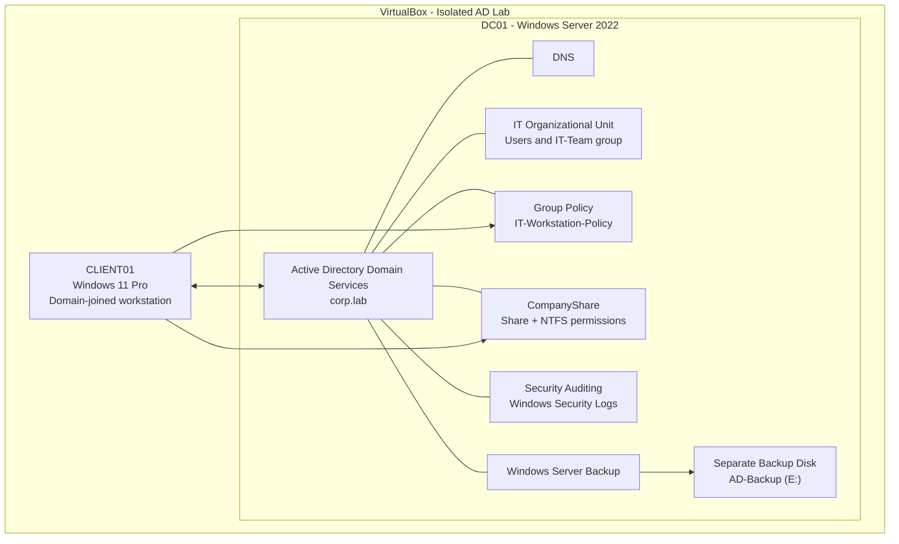

# UdeeshaJayendra-windows-server-2022-active-directory-lab

# Windows Server 2022 Active Directory Administration Lab

A hands-on Windows Server administration project demonstrating Active Directory Domain Services (AD DS), centralized user management, Group Policy, file-sharing permissions, security auditing, and backup and recovery using Windows Server 2022 and Windows 11.

## Project Overview

This project implements a small enterprise-style Windows domain environment using VirtualBox. It demonstrates how a system administrator can centrally manage users, groups, client computers, access permissions, security policies, and backup operations.

The lab includes a Windows Server 2022 domain controller and a Windows 11 Pro domain-joined client. Configuration and validation were performed through Windows administrative tools and PowerShell.

## Objectives

- Deploy and configure a Windows Server 2022 domain controller.
- Create an Active Directory domain and organize users and groups.
- Join a Windows 11 client to the domain.
- Apply and test Group Policy restrictions.
- Configure shared-folder permissions using share permissions and NTFS permissions.
- Verify authorized and unauthorized access.
- Enable security auditing and inspect relevant Security event logs.
- Configure Windows Server Backup using a separate virtual disk.
- Perform and verify an actual file-level recovery operation.

## Lab Environment

| Component | Configuration |
|---|---|
| Virtualization platform | Oracle VirtualBox |
| Server operating system | Windows Server 2022 Evaluation |
| Client operating system | Windows 11 Pro |
| Domain controller | `DC01` |
| Client computer | `CLIENT01` |
| Active Directory domain | `corp.lab` |
| NetBIOS domain name | `CORP` |
| Organizational Unit | `IT` |
| Security group | `IT-Team` |
| File share | `\\DC01\CompanyShare` |
| Backup destination | Separate virtual disk, `E:` (`AD-Backup`) |

## Architecture



**Architecture summary:** `DC01` provides domain authentication, directory services, DNS support, Group Policy, file sharing, security auditing, and backup services. `CLIENT01` is joined to `corp.lab` and is used to test domain sign-in, policy application, and shared-folder access.

*This diagram represents the logical lab design, not a high-availability or production deployment.*

## Implementation and Testing

### 1. Domain Controller Configuration

Installed Active Directory Domain Services and promoted `DC01` to a domain controller for `corp.lab`. Configured the server's static IPv4 address and DNS settings.

Key tasks:
- Configured the server network settings.
- Created the Active Directory domain.
- Signed in using the domain administrator account.
- Verified the domain structure and directory objects.

**Evidence**


### 2. Active Directory Users, Groups and Organizational Units

Created the `IT` Organizational Unit to organize directory objects and the `IT-Team` Global Security group to manage access through group membership.

Configured domain users, including:
- `CORP\udeesha` — member of `IT-Team`.
- `CORP\Test` — test account used to validate restricted file-share access.

Using security groups makes permissions easier to manage than assigning access individually to every user.

### 3. Domain-Joined Windows Client

Joined `CLIENT01`, running Windows 11 Pro, to the `corp.lab` domain and tested sign-in with the domain user `CORP\udeesha`.

This demonstrates centralized authentication through Active Directory.

**Evidence**


### 4. Group Policy Management

Created and linked the `IT-Workstation-Policy` Group Policy Object to the `IT` OU.

Configured the following policy:

`User Configuration → Policies → Administrative Templates → Control Panel → Prohibit access to Control Panel and PC settings`

Set the policy to **Enabled** and tested its effect on the domain-joined client.

This demonstrates centralized application of user restrictions through Group Policy.

**Evidence**


### 5. File Sharing and Access Control

Created the `C:\CompanyShare` folder on `DC01` and shared it as:

`\\DC01\CompanyShare`

Configured permissions at two levels:

| Permission layer | Assigned access |
|---|---|
| Share permissions | `CORP\IT-Team`: Change and Read |
| NTFS permissions | `CORP\IT-Team`: Modify |

Both permission layers apply to network access. Effective access is determined by the combination of share and NTFS permissions.

**Validation performed:**
- The authorized user `CORP\udeesha` accessed the share and created or updated a test file.
- The `CORP\Test` account was denied access.
- The access-denied result confirmed that the configured access restrictions were working as intended.

**Evidence**


### 6. Security Auditing and Event Logs

Configured the `Domain-Security-Auditing` Group Policy to audit logon activity and user account management, with success and failure auditing enabled for the relevant audit subcategories.

Verified the audit configuration and inspected the Windows Security event log.

Evidence includes:
- **Event ID 4624:** Successful logon.
- **Event ID 4720:** User account created.

These events demonstrate how Windows security logs can help administrators investigate account activity and monitor changes in the domain.

**Evidence**


### 7. Windows Server Backup

Installed Windows Server Backup and attached a separate 15 GB virtual disk to the domain controller. Initialized and formatted the disk as NTFS, with drive letter `E:` and label `AD-Backup`.

Created a backup of the `C:` volume and critical volumes using:

```powershell
wbadmin start backup -backupTarget:E: -include:C: -allCritical -quiet
```

Verified the available backup version and its recoverable contents using `wbadmin`.

**Evidence**


### 8. Actual File Recovery Test

To validate recovery without overwriting the original server file, used the separate `DC01-RecoveryTest` virtual machine with its network adapter disabled.

Restored the Windows `hosts` file from the backup version dated 28 October 2026 to an alternate location:

- **Backup source:** `AD-Backup` (`E:`)
- **Original file:** `C:\Windows\System32\drivers\etc\hosts`
- **Recovery destination:** `C:\RecoveryTest\hosts`

The Windows Server Backup recovery command reported successful completion. Verified that the restored file existed, had a size of 824 bytes, and had the same SHA-256 hash as the current original file.

**Results:**

| Validation | Result |
|---|---|
| Backup version detected | Passed |
| File recovery operation | Successful |
| Restored file exists | Passed |
| Files recovered | 1 |
| Files failed | 0 |
| SHA-256 comparison | Matching hashes |

**Evidence**


This validates file-level recovery from the backup. It does **not** establish that a full System State or bare-metal recovery has been successfully tested.

## Skills Demonstrated

- Windows Server administration
- Active Directory Domain Services (AD DS)
- Domain users, groups, and Organizational Units
- DNS and domain networking fundamentals
- Windows 11 domain joining and authentication
- Group Policy configuration and validation
- SMB file sharing and NTFS permissions
- Security auditing and Windows Event Viewer
- Windows Server Backup and `wbadmin`
- File recovery and SHA-256 verification
- VirtualBox-based lab deployment and testing
- Technical documentation and evidence collection

## Limitations and Future Improvements

This project is a learning lab, not a production-ready enterprise deployment.

Potential future improvements:
- Test Active Directory System State recovery in an isolated recovery environment.
- Perform a bare-metal recovery exercise using appropriate Windows Server recovery media.
- Add a second domain controller to explore redundancy and replication.
- Extend monitoring and centralized logging.
- Document recovery procedures and disaster-recovery objectives.

System State and bare-metal recovery have **not** been tested as part of the completed lab.

## Repository Structure

```text
windows-server-2022-active-directory-lab/
├── README.md
└── evidence/
    ├── 02-corp-administrator-login.png
    ├── 03-dc01-static-ip.png
    ├── 06-ad-users-groups-ous.png
    ├── 09-client-domain-join-success.png
    ├── 10-domain-user-login.png
    ├── 12-companyshare-permissions.png
    ├── 13-it-workstation-policy.png
    ├── 14-active-directory-file-sharing-demo.mp4
    ├── 14-client-shared-folder-access.png
    ├── 14-companyshare-test-file-created.png
    ├── 17-security-successful-logon-event.png
    ├── 18-security-user-account-created-event.png
    ├── 19-file-share-access-denied-testuser.png
    ├── 20-dc01-backup-disk-ready.png
    ├── 21-dc01-backup-creation-and-verification.png
    └── 23-backup-file-recovery-test.png
```

*Use the filenames shown here consistently, or update the README paths to match the actual files in your repository. Only include evidence files that you have actually captured.*

## Conclusion

This project demonstrates practical Windows Server administration through a working Active Directory domain, a joined Windows client, centralized Group Policy, controlled file sharing, security auditing, and verified file-level backup recovery.

It provides hands-on experience with core systems administration tasks and a documented foundation for further study in Windows infrastructure and enterprise IT operations.
